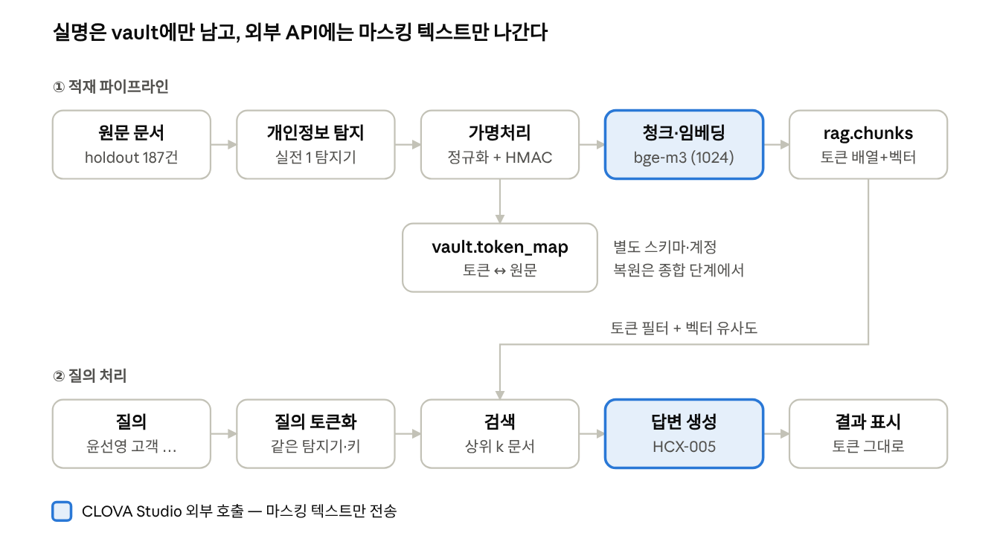
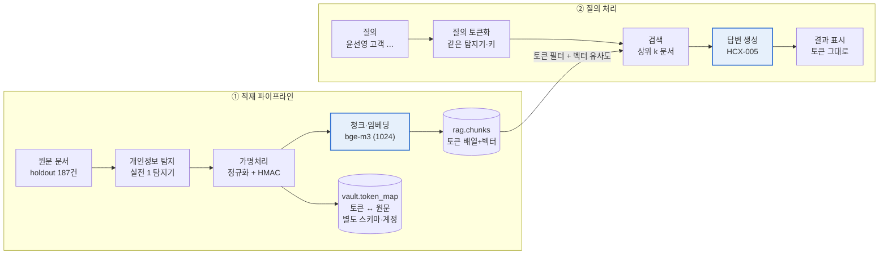

# 실전 프로젝트 2 연구 계획서

## 1. 연구 개요

실전 2는 실명이 하나도 없는 데이터로도 "윤선영 고객 상담 내역 찾아줘"가 동작하는지 검증합니다. 실전 1에서 고른 탐지기를 파이프라인 앞단에 두고, 그 뒤에 가명처리·벡터 DB 적재·토큰 기반 검색·답변 생성을 붙여 기본형 챗봇을 만듭니다.

**배경.** 금융사 사내 문서(상담 기록, 민원, 메일, 회의록)에는 고객 실명·연락처·주민등록번호·계좌번호가 섞여 있습니다. 단순 마스킹(`***`)은 개인정보를 지우는 대신 "같은 사람이 어느 문서에 나오는지"라는 연결 정보까지 지워, 이름 기반 검색과 분석이 불가능해집니다.

**문제 정의.** 개인정보를 **결정적 토큰**(같은 값이면 항상 같은 토큰, 예: `<PERSON_03f0d420>`)으로 치환하면, 외부 LLM·임베딩 API에는 실명을 보내지 않으면서도 토큰 단위로 문서를 연결하고 검색할 수 있습니다. 이 연구는 그 가설이 실제 데이터에서 어디까지 성립하고 어디서 깨지는지를 측정합니다.

**실전 1과의 연결.** 실전 1의 산출물(탐지기와 오류 분석)이 실전 2의 입력입니다. 탐지기가 놓친 개인정보는 그대로 벡터 DB에 들어가고, 탐지 경계가 틀리면 같은 사람이 다른 토큰으로 쪼개집니다. 따라서 실전 2의 결과는 실전 1 탐지기 품질을 검색 관점에서 다시 평가하는 역할도 합니다.

## 2. 연구 목표와 연구 질문

목표는 **가명처리된 데이터만으로 holdout 검색 질의 88개(16개 유형)에 대해 정답 문서를 찾아내고, 그 성능을 좌우하는 요인을 질의 유형별로 설명하는 것**입니다. 세부 목표는 세 가지입니다.

1. 같은 사람의 다른 표기(`윤 선영`, `윤선영`, `윤선영은`)가 같은 토큰이 되는 가명처리 모듈을 만든다.
2. 마스킹 텍스트만 임베딩하고, 토큰 필터 + 의미 검색으로 동작하는 검색 챗봇을 만든다.
3. 토큰 일관성과 검색 정확도를 수치로 측정하고, 실패 사례의 원인을 분류한다.

| 번호 | 연구 질문 | 확인 방법 |
| --- | --- | --- |
| RQ1 | 정규화(공백·조사·하이픈 제거)만으로 같은 사람의 표기 변형이 얼마나 하나의 토큰으로 묶이는가? | `check_token_consistency.py`의 미탐·쪼개짐, `token_consistency_cases.csv` 사례 분석 |
| RQ2 | 이름 문자열 기준 토큰에서 동명이인은 얼마나 합쳐지고, 검색에 어떤 영향을 주는가? | 합쳐짐(동명이인) 토큰 수 + 동명이인 질의 8개의 Confuse@10 |
| RQ3 | 토큰을 검색에 어떻게 쓰면(필터 any·all, 점수 결합) 의미 검색만 할 때보다 얼마나 좋아지는가? | 검색 버전별 run 파일을 질의 유형별 Recall@5·MRR로 비교 |
| RQ4 | 질의 쪽 탐지가 이름을 놓치면 검색은 어떻게 되는가? | run 파일의 `query_tokens`가 빈 이름 질의를 따로 모아 Hit@5 비교 |
| RQ5 | 탐지 품질이 최종 검색 점수를 얼마나 좌우하는가? | 선정 탐지기 vs 규칙 기준선 vs 정답 라벨 가명처리(탐지가 완벽할 때의 상한선) |

## 3. 연구 범위

실전 2는 "가명처리된 데이터로도 검색이 된다"를 확인하는 **기본형**입니다. 단일 탐지기와 이름 문자열 기준 토큰으로 단순하게 구현하고, 운영 기능은 종합 단계로 넘깁니다.

| 항목 | 실전 2 (이번 연구) | 종합으로 미룸 |
| --- | --- | --- |
| 탐지기 | 실전 1 선정 탐지기 1개 | 적재용·재검사용 탐지기 분리 |
| 토큰 | 정규화된 이름 문자열 기준 HMAC | 동명이인 구분(문맥·연락처 결합 등) |
| 답변 표시 | 토큰이 들어간 그대로 | 권한별 실명 복원 |
| 접근 통제 | 없음 | 역할별 권한, 검색 전 문서 필터 |
| 출력 보호 | 없음 (LLM 답변 그대로) | 답변 재검사 후 표시 |
| 평가 | 토큰 일관성 + holdout 검색 질의 88개 | 탐지·일관성·검색·유출 통합, holdout |
| 형태 | Streamlit 데모 | API 서비스 |

제외 사항이라도 구현 과정에서 드러난 문제(동명이인 합쳐짐 등)는 원인과 영향을 기록해 종합 설계의 근거로 넘깁니다.

## 4. 데이터와 실험 환경

**holdout 코퍼스를 실전 2의 적재·검색 평가 대상**으로 지정합니다. 그래서 규칙·정규화 개선은 dev·test로만 하고, holdout은 버전별 점수를 재는 데만 씁니다. holdout 결과를 보고 규칙을 고치면 종합의 최종 평가가 의미를 잃기 때문입니다.

| 데이터 | 규모 | 실전 2에서의 용도 |
| --- | --- | --- |
| dev | 100건 (개체 548개, person 340개) | 탐지·정규화 규칙 개선, 오류 분석 |
| test | 200건 | 규칙 변경 후 중간 확인 (dev 과적합 점검) |
| `holdout_labeled.jsonl` | 187건 (실전 1 holdout과 같은 파일) | 적재·검색 대상 코퍼스. 정답 라벨(entities)은 적재에 쓰지 않음 |
| `holdout_retrieval_queries.jsonl`  • `_gold` | 질의 88개, 16개 유형 | Hit@k·Recall@k·MRR·Confuse@10 채점 |
| `holdout_persons_gold.jsonl` | 문서별 인물 ID | 토큰 일관성 채점 전용 (토큰 생성에 쓰면 정답을 보는 것) |

| 구성 요소 | 선택 | `.env` 설정과 비고 |
| --- | --- | --- |
| 벡터 DB | `pgvector/pgvector:pg16` (docker compose), DB `pii_rag` | `rag_user`·`vault_user` 계정 분리, 서로의 스키마 접근 불가 |
| 임베딩 | CLOVA Studio `bge-m3` (1024차원) | `EMBED_PROVIDER=api`, `EMBED_API_BASE`=CLOVA OpenAI 호환 URL, `EMBED_MODEL=bge-m3`, **`EMBED_DIM=1024`** (기본값 1536에서 변경) |
| 답변 LLM | CLOVA Studio `HCX-005` | `LLM_API_BASE`=같은 URL, `LLM_MODEL=HCX-005` |
| 흐름 확인용 | 로컬 해시 임베딩 | `EMBED_PROVIDER=local` (API 없이 파이프라인만 확인, 품질 낮음) |
| UI | Streamlit (`starter/chat.py` 기반) | 질의 토큰화·검색 근거 표시 |
| 실행 환경 | CPU (DB는 로컬 Docker) | `ingest`·`run_queries`가 ms/문서·ms/질의를 출력 |

**지켜야 할 원칙.** `.env`(DB 비밀번호 3개, API 키, `HMAC_KEY`)는 커밋하지 않습니다(`.gitignore`에 포함). 팀 전원이 같은 `HMAC_KEY`를 써야 같은 토큰이 나옵니다. 임베딩·LLM API에는 가명처리된 텍스트만 보냅니다.

## 5. 시스템 설계

파이프라인은 적재와 질의 두 흐름입니다. 실명은 `vault` 스키마에만 남고, 외부 API(CLOVA Studio)로는 마스킹 텍스트만 나갑니다.

질의는 적재와 같은 탐지기·정규화·HMAC 키로 토큰화해야 문서 쪽 토큰과 일치합니다.

**가명처리 규칙.** 탐지된 값을 라벨별로 정규화한 뒤 `HMAC-SHA256(키, "라벨:정규화값")`의 앞 8자리로 토큰을 만듭니다. 라벨을 메시지에 넣어, 같은 숫자열이라도 라벨이 다르면 다른 토큰이 됩니다.

| 라벨 | 정규화 | 예시 |
| --- | --- | --- |
| person | 공백 제거, 끝에 붙은 조사 제거 | `윤 선영`, `윤선영은` → `윤선영` → `<PERSON_…>` |
| 전화·주민·계좌·카드번호 | 숫자만 남김 | `010-0349-2063` → `01003492063` → `<PHONE_…>` |
| email | 소문자 변환 | `SY.Yoon07@…` → `sy.yoon07@…` |
| address | 공백·쉼표 제거 | 표기 차이만 있는 같은 주소를 하나로 |

**DB 스키마.** 검색용과 매핑용을 다른 스키마·계정에 둬서, 검색 계정으로는 실명에 접근할 수 없게 합니다.

| 테이블 (계정) | 주요 컬럼 | 인덱스 |
| --- | --- | --- |
| `rag.chunks` (`rag_user`) | chunk_id(예: `H0001#0`), doc_id, chunk_idx, doc_type, masked_text, tokens `TEXT[]`, embedding `vector(EMBED_DIM)` | tokens: GIN, embedding: HNSW(코사인), doc_id |
| `vault.token_map` (`vault_user`) | token, label, normalized, originals(실제 등장 표기 목록) | token: PK |

**청크.** 스타터대로 가명처리 **후에** 줄 단위로 600자까지 이어 붙여 자릅니다. 원문을 먼저 자르면 이름·번호가 경계에서 잘려 탐지를 놓칠 수 있기 때문입니다. holdout 문서는 대부분 짧아 청킹 방식의 차이가 작을 수 있고, 그것도 결과로 기록합니다. 문서 유형을 임베딩 입력 앞에 붙이는 방식은 선택 실험으로 둡니다.

**검색 절차.**

1. 질의에서 개인정보를 탐지해 토큰으로 바꾼다.
2. 토큰이 있으면 `tokens && 질의토큰`(하나라도 포함) 또는 `tokens @> 질의토큰`(모두 포함)으로 거른 뒤 코사인 유사도로 정렬한다.
3. 결과가 k개 미만이면 순수 의미 검색으로 채운다 (질의 탐지 누락 대비).
4. 청크를 문서 단위로 중복 제거해 상위 k개를 남긴다.
5. HCX에 마스킹 청크만 넘기고, 토큰을 바꾸지 말 것과 근거 문서 ID를 붙일 것을 지시한다.

**스타터 코드에서 교체할 곳.** 각 파일의 입출력 약속만 지키면 나머지 코드(적재·채점)는 그대로 동작합니다. 미리 만든 규칙 탐지기와 가명처리 모듈은 이 약속에 맞게 옮겨 넣습니다.

| 파일 | 스타터 상태 | 팀 작업 | 지켜야 할 약속 |
| --- | --- | --- | --- |
| `starter/pii_pipeline.py` | 데모: 전화·이메일만 탐지, 문서 안에서만 번호를 매긴 토큰(`<PHONE_NUMBER_1>`) | 실전 1 탐지기 연결 + HMAC 가명처리, `IS_DEMO = False` | `detect(text)` → `[{label, start, end}]` / `pseudonymize(text, spans)` → `(masked, records)`, records에 label·start·end·original·normalized·token. 위치는 원문 기준, 토큰은 `TOKEN_PATTERN`에 맞게 |
| `starter/search.py` | 의미 검색만, 질의 토큰은 뽑기만 함 | 토큰 필터·점수 결합 설계 | `search(query, k, conn)` → `(masked_query, query_tokens, docs)`, `rag_user`만 사용 |
| `starter/chat.py` | 검색 + LLM, 토큰 그대로 표시 | 답변 프롬프트 개선, Streamlit 연결 | vault 접근 없음 |
| `starter/ingest.py`, `embed.py` | 줄 단위 600자 청킹, OpenAI 호환 임베딩 | 그대로 사용 (필요하면 CLOVA 호환 수정) | 청킹은 가명처리 후, 청크별 토큰 목록 저장, `outputs/pseudo_*.jsonl` 형식 유지 |

## 6. 실험 설계와 평가 지표

토큰 일관성은 holdout 187건, 검색 성능은 질의 88개에서 스타터 채점 도구로 측정합니다. 놓친 문서가 더 위험하므로 Recall@5(전체·유형별)를 주 지표로, 동명이인 질의는 Confuse@10을 함께 봅니다.

| 지표 | 정의 | 측정 도구 |
| --- | --- | --- |
| 미탐 | 정답 이름 구간이 토큰으로 바뀌지 않고 원문으로 남은 비율 | `check_token_consistency.py` |
| 쪼개짐 | 한 인물이 2개 이상의 토큰으로 나뉜 비율 | `check_token_consistency.py` |
| 합쳐짐 - 동명이인 | 이름이 같은 다른 인물이 한 토큰으로 묶인 수 (기본형에서는 예상된 결과) | `check_token_consistency.py` |
| 합쳐짐 - 그 외 | 이름이 다른 인물이 한 토큰으로 묶인 수 (목표 0) | `check_token_consistency.py` |
| Hit@1 · Hit@5 | 상위 k개에 정답 문서가 하나라도 있는 질의 비율 | `eval_holdout_retrieval.py` |
| Recall@5 · Recall@10 | 정답 문서 중 상위 k개에 들어온 비율의 평균 | `eval_holdout_retrieval.py` |
| MRR | 첫 정답 문서 순위의 역수 평균 | `eval_holdout_retrieval.py` |
| Confuse@10 | 상위 10개 중 동명이인 등 혼동 문서 비율, 낮을수록 좋음 (혼동 문서가 정의된 질의 29개) | `eval_holdout_retrieval.py` |
| 처리 시간 | 문서당 탐지+가명처리·임베딩 ms, 질의당 ms (CPU) | `ingest`·`run_queries` 출력 |
| 외부 전송 안전성 | 임베딩·LLM으로 나간 텍스트에 남은 원문 값 건수 (목표 0) | 전송 직전 검사 로그 |

질의 88개는 16개 유형이며, 비교가 쉽도록 다섯 묶음으로 나눠 봅니다. 예상은 검증할 가설입니다.

| 묶음 | 유형 (질의 수) | 예상 |
| --- | --- | --- |
| 이름 기반 (26) | name_topic 8, name_variant 6, person_all 6, role_agent 6 | 토큰 필터 효과가 가장 큼. 이름 변형은 정규화에 좌우됨 |
| 값·주소 기반 (25) | value_exact 7, value_format_variant 6, address_exact 4, address_format_variant 4, address_partial 4 | 형식 변형은 정규화로 해결. 주소 일부 질의는 토큰이 달라져 의미 검색에 의존 |
| 혼합 (21) | hybrid_paraphrase 7, hybrid_person_content 6, hybrid_within_type 4, hybrid_status 4 | 토큰으로 후보를 좁히고 의미로 순위를 매기는 결합 방식이 유리 |
| 동명이인 (8) | hybrid_homonym_semantic 6, homonym_role 2 | 이름 문자열 토큰이라 Confuse@10이 높게 나올 것 |
| 개인정보 없음 (8) | semantic_no_pii 8 | 토큰과 무관, 버전 간 차이가 작아야 정상 |

**비교 실험.** 한 번에 한 조건만 바꾸고, 버전마다 `run_queries.py --out outputs/run_<버전>.jsonl`로 결과를 따로 저장해 유형별 점수를 비교합니다.

| 버전 | 조건 | 답하는 질문 |
| --- | --- | --- |
| v0 | 스타터 데모 그대로 (전화·이메일만 마스킹, 의미 검색, local 임베딩) | 기준점. 이름이 안 가려져 점수가 그럴듯하게 나오는 착시 확인 |
| v1 | 선정 탐지기 + HMAC 가명처리, 의미 검색만 | RQ1 · 가명처리 자체의 비용 |
| v2 | v1 + 토큰 필터 any(`&&`), 모자라면 의미 검색으로 보충 | RQ3 |
| v3 | v1 + 토큰 필터 all(`@>`), 모자라면 any→의미 검색 순으로 보충 | RQ3 |
| v4 | 필터 대신 점수 결합 (의미 점수 + 토큰 일치 가산점) | RQ3 · RQ4 |
| v5 | 최선 검색 + 정규화 변형 (조사 제거, 문서 내 이름 연결 on/off) | RQ1 · RQ2 |
| B | 최선 검색 + 규칙 기준선 탐지기 | RQ5 |
| UB | 최선 검색 + 정답 라벨(entities)로 가명처리 — 탐지가 완벽할 때의 상한선, 비교 전용 | RQ5 |

v0은 이름이 그대로 남아 있어 API 대신 local 임베딩으로 돌리고, 공정한 비교를 위해 v1도 local로 한 번 더 돌립니다.

**오류 분석.** 검색에 실패한 질의는 원인을 네 가지로 분류해 건수를 세고, 대표 사례를 보고서에 싣습니다. ① 질의 탐지 누락(run 파일의 `query_tokens`), ② 토큰 쪼개짐, ③ 동명이인 합쳐짐(②·③은 `token_consistency_cases.csv`), ④ 의미 검색 순위 문제입니다.

## 7. 사전 관찰 결과 (dev, 규칙 기준선)

규칙 기반 기준선 탐지기로 dev 100건을 가명처리해 본 결과, 탐지는 거의 다 됐지만 **토큰 일관성에서 쪼개짐 7명, 합쳐짐 4건**이 나왔습니다. 실전 2의 핵심 문제는 탐지보다 토큰화 단계에 있다는 뜻입니다.

- **탐지 재현율(겹침 기준):** 547/548. 놓친 1건은 메신저의 `은서랑`에서 성 없이 쓴 이름 `은서`입니다.
- **토큰 일관성:** 인물 65명 중 7명이 여러 토큰으로 쪼개졌고, 토큰 4개가 두 사람을 하나로 합쳤습니다.

| 유형 | 사례 | 원인 | 처리 방향 |
| --- | --- | --- | --- |
| 합쳐짐 (3건) | 이서연, 박도윤, 김민준 (각 동명이인 2명) | 이름 문자열만으로 토큰을 만드는 구조적 한계 | 실전 2에서는 영향만 기록, 종합에서 해결 |
| 합쳐짐 (1건) | `조민준`과 `민준 씨`가 묶임 | 문서 내 이름 연결 규칙이 다른 사람을 연결 | E1에서 연결 규칙 켜기/끄기 비교 |
| 쪼개짐 (7명) | `지영 씨`, `수아 씨`가 `최지영`, `허수아`와 다른 토큰 | 성 없이 이름만 나오고 같은 문서에 성+이름이 없음 | 문서 간 연결은 오결합 위험이 커서 신중히 검토 |

두 가지를 주의합니다. 첫째, 기준선의 오탐 제거용 불용어는 dev를 보며 추가한 것이라 test에서 오탐이 다시 늘 수 있고, 늘어난다면 dev 과적합의 근거로 기록합니다. 둘째, 이 결과는 정답 데이터로 직접 센 수치이며, 공식 채점 도구(`check_token_consistency.py`)로 다시 확인해야 합니다.

## 8. 일정과 역할 분담

스타터를 받은 10월 29일부터 11월 3일 마감까지 단계별로 진행하고, 11월 4일에 발표합니다. 첫날 데모(v0)를 그대로 돌려 기준점을 박아 두고, 검색 버전 비교에 가장 많은 날짜를 둡니다.

| 날짜 | 작업 | 완료 기준 |
| --- | --- | --- |
| 10/29 (목) | `.env` 작성(CLOVA URL, `EMBED_DIM=1024`, HMAC 키), `docker compose up -d`, 데모 그대로 적재·평가(v0, local 임베딩) | v0 점수, 토큰 충돌 경고·이름 미탐 100% 확인 |
| 10/30 (금) | `pii_pipeline.py` 교체(선정 탐지기 + HMAC), dev·test로 정규화 점검, holdout 적재(API 임베딩), 토큰 일관성 채점 | v1 점수, `token_consistency_cases.csv` |
| 10/31 (토) ~ 11/1 (일) | `search.py` 설계 v2~v4, 정규화 변형 v5, B·UB 실행 | 버전별·유형별 비교표 |
| 11/2 (월) | 실패 원인 분류, Streamlit 데모(`chat.py` 기반), 대화 시연 캐처 | 실패 원인별 건수, 시연 4종 캡처 |
| 11/3 (화) | 보고서·발표 자료 작성, 코드 정리·제출 | 산출물 5종 제출 |
| 11/4 (수) | 발표 | — |

**역할 분담.**

| 작업 단위 | 범위 (스타터 파일) | 담당 |
| --- | --- | --- |
| 환경·DB | `.env`, docker compose, 적재 실행(`ingest.py`), CLOVA 임베딩 호환 확인(`embed.py`) |  |
| 가명처리 | `pii_pipeline.py` 교체, 정규화·HMAC, 토큰 일관성 원인 분석 |  |
| 검색 | `search.py` 설계, `run_queries.py` 버전별 실행, 유형별 평가 |  |
| LLM·데모 | `chat.py` 프롬프트(HCX-005), Streamlit |  |
| 보고서·발표 | 실험 결과 정리, 시연 예시, 발표 자료 |  |

## 9. 위험 요소와 산출물

가장 큰 위험은 두 가지입니다. Colab에서는 Docker를 띄울 수 없고, 스타터 기본 설정(`EMBED_DIM=1536`, OpenAI 형식 임베딩 호출)이 CLOVA `bge-m3`와 맞지 않을 수 있습니다. 둘 다 10/29에 확인합니다.

| 위험 | 영향 | 대응 |
| --- | --- | --- |
| Colab에서 Docker 실행 불가 | 적재·검색 단계 지연 | 팀원 1명 PC에 DB를 띄우고 나머지는 접속. 탐지·가명처리 점검은 DB 없이 Colab에서 진행 |
| `EMBED_DIM` 불일치 (기본 1536, bge-m3는 1024) | 적재 시 차원 오류 | 첫 `docker compose up` 전에 `.env`에 1024 설정. 이미 띄웠다면 `docker compose down -v` 후 다시 up |
| CLOVA 임베딩 호출 방식 차이 (`embed.py`는 64개 묶음 요청, `encoding_format` 미지정) | 임베딩 실패 또는 형식 오류 | 오류 시 요청에 `encoding_format: "float"` 추가, 묶음 크기 축소 |
| CLOVA 테스트 키 호출 한도(429) | 적재·버전별 재적재가 중간에 끊김 | 재시도·대기 추가. 검색 버전만 바꿀 때는 재적재하지 않음 |
| 데모 상태로 API 임베딩 사용 | 이름·주소 원문이 외부 API로 전송 | v0은 local 임베딩으로만 실행, `IS_DEMO = False` 전에는 API 사용 금지 |
| holdout에 가상 과적합 | 종합 최종 평가가 의미를 잃음 | 규칙 수정은 dev·test 근거로만, holdout은 버전 측정에만 사용 |
| 정답 라벨·인물 ID 오용 (공지: 채점과 비교 실험에만 사용) | 평가 무효 | entities는 UB 실험에만, 인물 ID는 채점에만 사용 (코드 분리) |
| 팀원마다 다른 HMAC 키 사용 | 같은 사람이 다른 토큰이 되어 검색 실패 | 키 1개를 팀 비공개 채널로 공유, 저장소에는 `.env.example`만 |
| LLM이 토큰을 바꾸거나 지어냄 | 답변 토큰이 매핑 테이블과 안 맞음 | 프롬프트에 토큰 유지 규칙 명시, 답변 속 토큰이 검색 문서에 있는지 확인 |

**산출물 (11/3 제출)**

- [ ]  가명처리 모듈 — 교체한 `starter/pii_pipeline.py` (`IS_DEMO = False`)
- [ ]  토큰 일관성 채점 결과 — 미탐·쪼개짐·합쳐짐(동명이인/그 외)과 `token_consistency_cases.csv` 기반 원인 분석
- [ ]  검색 평가 결과 — 질의 88개, 버전별(v0~v5, B, UB)·유형별 Hit@k·Recall@k·MRR·Confuse@10
- [ ]  챗봇 데모 — `chat.py` 기반 Streamlit
- [ ]  대화 시연 예시 — 일반 질의, 이름 변형, 동명이인, 질의 탐지 누락