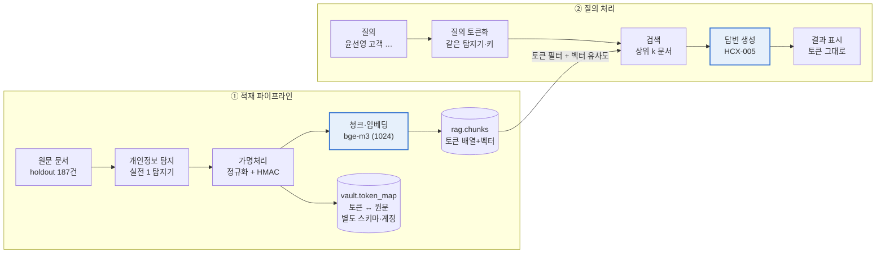

# 실전 2 연구 계획서 — 가명처리 기반 검색 챗봇

## 1. 연구 개요

실전 2는 실명이 하나도 없는 데이터로도 "윤선영 고객 상담 내역 찾아줘"가 동작하는지 검증합니다. 실전 1에서 고른 탐지기로 개인정보를 찾고, 결정적 토큰으로 가명처리한 뒤, 토큰과 의미 검색으로 문서를 찾고 LLM이 답하는 기본형 챗봇을 만들고 평가할 계획입니다.

**배경.** 금융사 사내 문서(상담 기록, 민원, 메일, 회의록)에는 고객 실명·연락처·주민등록번호·계좌번호가 섞여 있습니다. 이 문서를 LLM·임베딩 API에 그대로 넣으면 개인정보가 외부로 나가고, 단순 마스킹(`***`)을 하면 "같은 사람이 어느 문서에 나오는지"라는 연결까지 사라져 검색이 불가능해집니다.

**실전 1과의 연결.** 실전 1에서 선정한 탐지기(CPU 학습 KLUE-RoBERTa-small v1 + 후처리 + 규칙 탐지기)가 실전 2의 입력입니다. 실전 1에서 남긴 오류(이름 미탐, 경계 오류, 오탐)가 가명처리·검색·답변 단계에서 어떤 문제로 이어지는지 확인하는 것도 이번 연구의 목적입니다.

## 2. 문제 정의

실전 2의 핵심 문제는 **개인정보를 숨기는 일과 문서를 찾는 일이 서로 부딪힌다**는 점입니다. 가명처리는 원문을 가리면서도 같은 사람·같은 값을 연결할 수 있어야 하고, 그 연결이 실제 검색과 답변에 쓰여야 합니다. 실전 1 결과, 데이터셋 구성, 스타터 키트 구조를 바탕으로, 이 요구가 깨질 것으로 예상되는 지점 8가지(P1~P8)를 정의하고 실험으로 확인합니다.

### 2.1 세 가지 요구와 실패 형태

| 요구 | 뜻 | 깨지면 생기는 일 |
| --- | --- | --- |
| 보호 | DB와 LLM·임베딩 API에 원문 개인정보가 없음 | 원문 노출 (외부 전송) |
| 연결 | 같은 값은 문서·질의를 가리지 않고 항상 같은 토큰, 다른 값은 다른 토큰 | 쪼개짐 (같은 사람이 여러 토큰), 합쳐짐 (다른 사람이 한 토큰) |
| 검색 | 토큰과 내용으로 원하는 문서를 찾고, LLM이 그 문서로 정확히 답함 | 검색 실패, 다른 사람 문서 혼입, 틀린 답변 |

오류는 단계를 따라 누적될 것입니다. 탐지가 놓치면 보호가 깨지고, 정규화가 틀리면 연결이 깨지며, 두 가지 모두 결국 검색 실패로 나타납니다. 그래서 검색 점수 하나로 판단하지 않고, 단계별 문제로 나눠 정의합니다.

### 2.2 예상되는 문제

| # | 문제 | 깨지는 요구 | 근거 | 확인할 실험 |
| --- | --- | --- | --- | --- |
| P1 | 탐지 누락이 곧 원문 노출 | 보호 | 실전 1 holdout 이름 재현율 0.946, 질의는 문맥이 짧음 | v0·v1 비교, B·UB, 오류 분석 |
| P2 | 같은 값이 다른 토큰이 됨 | 연결 | 띄어쓰기·조사·번호 형식 변형, 스타터 데모는 문서별 순번 토큰 | v0·v1, 토큰 일관성 채점 |
| P3 | 다른 사람이 같은 토큰이 됨 | 연결·검색 | 데이터셋에 동명이인 포함, 이름 문자열 기준 토큰 | 합쳐짐 수, Confuse@10, 동명이인 질의 |
| P4 | 의미 임베딩은 토큰을 구분 못함 | 검색 | 토큰은 의미 없는 무작위 문자열, 스타터는 의미 검색만 함 | v1-local vs v1-api, v2~v4 |
| P5 | 주소를 토큰 하나로 묶음 | 검색·보호 | 부분 주소 질의 유형이 평가에 포함 | address 유형별 점수, 시연 |
| P6 | 토큰에 역할 정보가 없음 | 검색 | 담당자 질의 유형(role_agent)이 평가에 포함 | role_agent 점수, 오류 분석 |
| P7 | LLM 답변의 정확성·범위 | 검색(답변) | LLM은 토큰을 바꾸거나 추측할 수 있고, 스타터 프롬프트는 단순함 | 프롬프트 실험, 시연 |
| P8 | 운영·평가 제약 | 전체 | CPU 전용 조건, 테스트 키 호출 한도, holdout 재사용 | 처리 시간 측정 |

### 2.3 문제별 설명

**P1. 탐지 누락이 곧 원문 노출이다.** 가명처리는 탐지된 구간만 바꾸므로, 탐지기가 놓친 값은 DB와 임베딩·LLM API로 그대로 나갑니다.

- 문서: 실전 1 탐지기는 holdout에서 이름 재현율 0.946으로, 이름 약 30건을 놓쳤습니다. 주로 외자 이름과 성 없이 이름만 쓴 경우이며, 학습 데이터(dev)에 이런 형태가 없었기 때문입니다. 이 이름들은 실전 2에서 원문으로 남을 것입니다.
- 질의: 질의는 문서보다 짧고 호칭·양식 같은 문맥 단서가 적어, 문서보다 탐지가 더 어려울 것으로 예상합니다. 질의 탐지가 놓치면 검색이 실패할 뿐 아니라 원문이 API로 전송됩니다.
- 확인 방법: 원문 노출률, 질의 토큰이 빈 질의 수, 탐지기를 바꾼 B·UB 비교.

**P2. 같은 값이 다른 토큰이 되면 연결이 끊긴다.** 토큰이 검색 열쇠가 되려면 표기가 달라도 같은 값은 같은 토큰이어야 합니다.

- 데이터셋에는 띄어 쓴 이름(`윤 선영`), 조사가 붙은 이름(`윤선영은`), 형식이 다른 전화번호(`01003492063`, `+82 10-…`)가 일부러 들어 있습니다.
- 스타터 데모는 문서 안에서만 번호를 매기는 토큰(`<PHONE_NUMBER_1>`)을 써서, 서로 다른 값이 같은 토큰을 쓰고 질의와 문서 토큰도 맞지 않습니다.
- 성 없이 이름만 쓴 등장(`지영 씨`)은 같은 문서에 성+이름이 없으면 연결할 근거가 없어, 정규화만으로는 쪼개짐이 남을 것입니다 (dev 사전 관찰에서도 확인).

**P3. 다른 사람이 같은 토큰이 되면 엉뚱한 문서가 섞인다.** 실전 2 기본형은 이름 문자열로 토큰을 만들기 때문에 동명이인을 구분하지 못합니다.

- 데이터셋에는 동명이인이 의도적으로 포함돼 있고, 평가 질의에도 동명이인 유형과 혼동 문서 목록이 있습니다.
- 토큰을 검색에 직접 쓰면 오히려 동명이인의 문서까지 끌어올려 혼동이 늘 것으로 예상합니다. 흔한 이름일수록 토큰 하나에 걸리는 문서가 많아집니다.
- 실전 2에서는 고치지 않고 원인과 영향을 측정해 종합 단계 설계 근거로 남깁니다.

**P4. 의미 임베딩은 토큰을 구분하지 못할 것이다.** `<PHONE_d79b642a>`와 `<PHONE_304b035a>`는 의미 임베딩 모델(bge-m3)에게 둘 다 "전화번호 같은 무언가"일 뿐입니다.

- 스타터의 검색은 의미 검색만 하고, 질의 토큰은 뽑기만 합니다. 이대로라면 이름·번호로 찾는 질의는 실패할 것으로 예상합니다.
- 반대로 테스트용 해시 임베딩은 글자 조각을 비교하므로 토큰 문자열이 같으면 맞을 수 있어, 두 임베딩을 비교하면 이 문제를 분리해서 볼 수 있습니다.
- 해결 가설: 이름·번호는 토큰으로(필터), 내용은 의미 검색으로 찾는 결합 검색.

**P5. 주소를 토큰 하나로 묶으면 지역 검색이 어렵다.** 주소 전체가 `<ADDRESS_…>` 하나가 되면 가명처리된 문서에 지역명이 남지 않습니다.

- 평가 질의에는 `대구 수성구 고객`처럼 주소 일부로 찾는 유형(address_partial)이 있습니다. 주소 일부는 토큰이 생기지 않거나, 생겨도 전체 주소 토큰과 같아질 수 없습니다.
- 반대로 시·구 단위를 원문으로 남기면 다른 정보와 결합해 개인을 좁힐 위험이 커집니다. 보호와 검색이 직접 부딪히는 지점이라, 실전 2에서는 영향을 측정하고 설계는 종합에서 다룹니다.

**P6. 토큰은 "누가 나오는지"만 알고 "어떤 역할인지"는 모른다.**

- 같은 사람이 어떤 문서에서는 고객, 다른 문서에서는 담당자나 참석자로 나옵니다. "○○ 직원이 처리한 건"같은 역할 질의(role_agent)에서는 다른 역할로 나온 문서가 섞일 것으로 예상합니다.

**P7. LLM 답변이 문서를 잘못 읽거나 범위를 오해하게 만들 수 있다.** 가명처리와 별개로 답변 단계에서 생길 수 있는 문제입니다.

- LLM이 토큰 글자를 바꾸거나 원래 값을 추측하면 매핑과 어긋납니다.
- 근거 문서를 밝히지 않으면, 토큰만 보는 사용자는 답변이 맞는지 확인하기 어렵습니다.
- 참고 문서 몇 건만 보고 답하므로, 관련 문서가 더 있어도 전부인 것처럼 답할 수 있습니다.
- 스타터 프롬프트는 "토큰을 그대로 쓰라"는 지시만 있어, 프롬프트 설계에 따라 답변이 어떻게 달라지는지 비교가 필요합니다.

**P8. 운영·평가 제약.**

- 운영 조건은 GPU 없는 CPU 서버이므로, 탐지·검색 처리 시간을 CPU 기준으로 측정해야 합니다.
- 임베딩·LLM은 테스트 API 키를 쓰므로 호출 한도가 적재 속도를 제한할 수 있습니다.
- holdout은 실전 2 평가 대상이자 종합 최종 평가 대상입니다. holdout을 보고 규칙을 고치면 최종 평가가 의미를 잃으므로, 실험 조건은 holdout 결과와 무관하게 미리 정합니다.

## 3. 연구 목표와 연구 질문

목표는 **가명처리된 데이터만으로 holdout 검색 질의 88개의 정답 문서를 찾고, 남는 실패가 P1~P8 중 어느 문제에서 오는지 설명하는 것**입니다.

1. 같은 값의 다른 표기가 같은 토큰이 되는 가명처리 모듈을 만든다 (P1·P2).
2. 마스킹 텍스트만 외부로 보내고, 토큰과 의미 검색을 결합한 검색 챗봇을 만든다 (P4·P7).
3. 토큰 일관성·검색 성능을 수치로 재고, 실패 사례를 문제별로 분류해 종합 단계 설계 근거로 남긴다 (P3·P5·P6·P8).

| 번호 | 연구 질문 | 관련 문제 | 확인할 실험 |
| --- | --- | --- | --- |
| RQ1 | 정규화와 HMAC 토큰만으로 표기 변형이 얼마나 한 토큰으로 묶이는가? | P2 | v0·v1, 토큰 일관성 채점 |
| RQ2 | 의미 검색만으로 가명처리된 이름·번호를 찾을 수 있는가? | P4 | v1-local vs v1-api |
| RQ3 | 토큰을 검색에 어떻게 쓰는 것이 가장 좋은가? | P4 | v2·v3·v4 |
| RQ4 | 동명이인·부분 주소·역할 질의는 얼마나, 왜 실패하는가? | P3·P5·P6 | 유형별 점수, Confuse@10, 오류 분석 |
| RQ5 | 탐지 품질이 최종 검색을 얼마나 좌우하는가? | P1 | B·UB |
| RQ6 | 프롬프트 설계에 따라 답변의 근거 표시·정확성이 어떻게 달라지는가? | P7 | 프롬프트 실험 ①②③ |

## 4. 연구 범위

실전 2는 "가명처리된 데이터로도 검색이 된다"를 확인하는 **기본형**입니다. P4는 검색 설계로 해결을 시도하고, 나머지 문제는 원인과 영향을 측정해 종합 단계로 넘깁니다.

| 항목 | 실전 2 (이번 연구) | 종합으로 넘김 | 관련 문제 |
| --- | --- | --- | --- |
| 탐지기 | 실전 1 선정 탐지기 그대로 | 학습 데이터 보강, 질의 탐지 보강 | P1 |
| 토큰 | 정규화 후 값 기준 HMAC | 동명이인 구분, 주소 토큰 단위, 역할 정보 | P2·P3·P5·P6 |
| 검색 | 토큰 활용 방식 비교 후 채택 | 권한별 문서 필터 | P4 |
| 답변 | 프롬프트 비교 후 채택, 토큰 그대로 표시 | 권한별 실명 복원 | P7 |
| 출력·전송 보호 | 없음 | API 전송 직전·답변 재검사 | P1·P7 |
| 평가 | 토큰 일관성 + holdout 질의 88개 | 탐지·일관성·검색·유출 통합 평가 | P8 |
| 형태 | Streamlit 데모 | API 서비스 | — |

## 5. 데이터와 실험 환경

강사 공지와 스타터 키트 모두 holdout 코퍼스를 실전 2의 적재·검색 평가 대상으로 지정합니다. 규칙·정규화 개선은 dev·test로만 하고, holdout은 버전별 점수를 재는 데만 씁니다.

| 데이터 | 규모 | 용도 |
| --- | --- | --- |
| dev | 100건 (개체 548개) | 탐지·정규화 규칙 개선 |
| test | 200건 | 규칙 변경 후 중간 확인 |
| `holdout_labeled.jsonl` | 187건 | 적재·검색 대상. 정답 라벨은 적재에 쓰지 않음 (UB 실험 제외) |
| `holdout_retrieval_queries` + `_gold` | 질의 88개, 16개 유형 | Hit@k·Recall@k·MRR·Confuse@10 채점 |
| `holdout_persons_gold.jsonl` | 문서별 인물 ID | 토큰 일관성 채점 전용 |

| 구성 요소 | 선택 | 비고 |
| --- | --- | --- |
| 벡터 DB | PostgreSQL 16 + pgvector (Docker) | 검색용 `rag_user`·매핑용 `vault_user` 계정 분리 |
| 탐지 | KLUE-RoBERTa-small v1 (CPU) + 후처리 + `rules_detector` | 실전 1 선정 탐지기 |
| 임베딩 | 테스트용 해시 임베딩 / CLOVA Studio `bge-m3` (1024차원) | 두 임베딩을 비교 (P4) |
| 답변 LLM | CLOVA Studio `HCX-005` | 마스킹 텍스트만 전송 |
| UI | Streamlit | 가명처리된 질의·질의 토큰·근거 문서 표시 |
| 측정 환경 | 노트북 CPU | 처리 시간은 CPU 기준 |

**지켜야 할 원칙.** `.env`와 `HMAC_KEY`는 저장소에 올리지 않고, 팀 전원이 같은 키를 씁니다. 임베딩·LLM API에는 가명처리된 텍스트만 보냅니다. 정답 라벨과 인물 ID는 채점과 비교 실험(UB)에만 씁니다.

## 6. 시스템 설계

파이프라인은 적재와 질의 두 흐름입니다. 실명은 `vault` 스키마에만 남기고, 외부 API(CLOVA Studio)로는 마스킹 텍스트만 보내도록 설계합니다.

질의는 문서와 같은 탐지기·정규화·HMAC 키로 토큰화해야 문서 쪽 토큰과 일치합니다. 검색 단계에서 토큰을 어떻게 쓸지는 7장의 v2~v4 실험으로 정합니다.

**가명처리 규칙.** 탐지된 값을 라벨별로 정규화한 뒤 HMAC-SHA256 앞 8자리로 토큰을 만듭니다 (예: `<PERSON_03f0d420>`). 번호류는 라벨과 상관없이 숫자 기준으로 해시해, 탐지기가 같은 번호를 다른 라벨로 잡아도 같은 토큰이 되게 합니다.

| 라벨 | 정규화 | 대응하는 문제 |
| --- | --- | --- |
| person | 공백 제거, 끝에 붙은 조사·호칭 제거, 같은 문서 안 이름만 쓴 등장을 성+이름에 연결 | P2 |
| 전화·주민·계좌·카드번호 | 숫자만 남김, `+82`→`0`, `+82` 앞부분까지 구간 확장 | P2 |
| email | 소문자 변환 | P2 |
| address | 시도명 축약, 공백·쉼표 제거 (주소 전체 = 토큰 하나) | P2 (P5는 영향 측정) |

**DB 스키마.** 검색 계정(`rag_user`)으로는 매핑 테이블에 접근할 수 없게 분리합니다.

| 테이블 (계정) | 주요 컬럼 | 인덱스 |
| --- | --- | --- |
| `rag.chunks` (`rag_user`) | chunk_id, doc_id, doc_type, masked_text, tokens `TEXT[]`, embedding `vector(1024)` | tokens: GIN, embedding: HNSW(코사인) |
| `vault.token_map` (`vault_user`) | token, label, normalized, originals | token: PK |

**스타터 코드에서 바꿀 곳.**

| 파일 | 계획 |
| --- | --- |
| `starter/pii_pipeline.py` | 데모 → 실전 1 탐지기 + 정규화 + HMAC 가명처리 |
| `starter/search.py` | 의미 검색만 → 토큰 활용 방식을 버전별로 전환할 수 있게 구현 (v1~v4) |
| `starter/embed.py` | CLOVA 임베딩 호환 확인, 필요하면 수정 |
| `starter/chat.py` | 프롬프트 ①②③ 비교, Streamlit 데모 연결 |

## 7. 실험 계획

실험은 네 가지입니다. 검색 실험(v0~v4, B, UB)으로 P1·P2·P4를, 프롬프트 실험으로 P7을, 시연과 오류 분석으로 P3·P5·P6을 확인합니다. 모든 실험은 **한 번에 한 조건만** 바꾸고, 조건은 holdout 결과를 보기 전에 정합니다.

### 7.1 평가 지표

놓친 문서가 더 위험하므로 Recall@5를 주 지표로, 동명이인은 Confuse@10을 함께 봅니다. 점수는 전체와 질의 유형별(16개)로 나눠 봅니다.

| 지표 | 정의 | 확인할 문제 |
| --- | --- | --- |
| 원문 노출률 | 정답 개인정보 중 가려지지 않은 비율 | P1 |
| 미탐 · 쪼개짐 · 합쳐짐(동명이인/그 외) | 이름 기준 토큰 일관성 (`check_token_consistency.py`) | P1·P2·P3 |
| Hit@1 · Hit@5 | 상위 k개에 정답이 하나라도 있는 질의 비율 | P4~P6 |
| Recall@5 · Recall@10 | 정답 문서 중 상위 k개에 들어온 비율 | P4~P6 |
| MRR | 첫 정답 순위의 역수 평균 | P4·P6 |
| Confuse@10 | 상위 10개 중 동명이인 등 혼동 문서 비율 (낮을수록 좋음) | P3 |
| 처리 시간 | 문서당 탐지+가명처리, 질의당 검색 (CPU) | P8 |

### 7.2 검색 실험 (v0~v4, B, UB)

버전마다 `run_queries.py --out outputs/run_<버전>.jsonl`로 결과를 따로 저장하고 유형별 점수를 비교합니다.

| 버전 | 바꾸는 조건 | 목적과 가설 | RQ |
| --- | --- | --- | --- |
| v0 | 스타터 데모 그대로 (전화·이메일만 탐지, 문서별 순번 토큰, 의미 검색, 해시 임베딩) | 기준선. 이름이 원문으로 남아 이름 질의 점수가 높게 보일 수 있음(착시), 번호 토큰 충돌 예상 | RQ1 |
| v1-local | 실전 1 탐지기 + 정규화 + HMAC (검색·임베딩은 v0과 같음) | 가명처리 효과만 분리. 번호·이름 토큰이 일관되어 값 질의가 오를 것 | RQ1 |
| v1-api | v1-local에서 임베딩만 bge-m3로 변경 | 임베딩 효과만 분리. 의미 질의는 오르고, 토큰에 의존하는 이름·번호 질의는 떨어질 것 (P4) | RQ2 |
| v2 | v1-api + 토큰 필터: 질의 토큰을 **하나라도** 가진 문서를 먼저, 모자라면 의미 검색으로 채움 | 이름·번호 질의 회복. 단, 동명이인 문서까지 끌어와 Confuse@10은 오를 것 (P3) | RQ3 |
| v3 | v2의 필터를 **모두 일치 → 하나라도 일치** 순으로 | 토큰이 여러 개인 질의(이름+번호 등)에서 순위 개선 | RQ3 |
| v4 | 거르지 않고 의미 점수 + 0.5 × (질의 토큰 일치 비율) | 필터와 점수 결합 중 어느 쪽이 나은지. 가중치 0.5는 미리 고정하고 holdout으로 조정하지 않음 | RQ3 |
| B | 채택한 검색 + 규칙 탐지기만 | 모델 없이 규칙만 쓰면 검색이 얼마나 달라지는지 (P1) | RQ5 |
| UB | 채택한 검색 + 문서는 정답 라벨로 가명처리 (질의는 모델) | 탐지가 완벽할 때의 상한선. 채택 버전과의 차이 = 탐지 개선의 여지 | RQ5 |
- v1을 해시·bge-m3 임베딩으로 각각 실행해 가명처리 효과와 임베딩 효과를 따로 봅니다.
- v0은 이름이 원문으로 남아 있어 API 임베딩을 쓰지 않고 해시 임베딩으로만 실행합니다.
- 기본 설정은 조절할 값이 적은 버전을 우선해 고릅니다 (holdout 과적합 방지).

### 7.3 프롬프트 실험

같은 질의·같은 검색 결과로 답변 프롬프트 세 가지를 비교해 데모에 쓸 것을 고릅니다 (`starter/chat.py`의 `SYSTEM`).

| 버전 | 내용 | 가설 |
| --- | --- | --- |
| ① 스타터 기본 | 문서 내용만 근거로 짧게 답하고, 토큰은 그대로 쓰며 원래 값을 추측하지 말 것 | 기준선. 근거 문서가 표시되지 않을 것 |
| ② 지시 목록 | ① + 토큰 글자 유지, 같은 토큰은 연결해 설명, 질문 값 반복 대신 업무 내용 요약, 근거 문서 ID 표시, 없으면 없다고 답하기 | 답변 내용이 풍부해지지만 지시 일부를 놓칠 수 있음 |
| ③ 지시 + 형식 예시 | ② + 답변 형식 예시 (가짜 토큰·은행 이름 사용) | 근거 ID·토큰 연결 같은 형식 지시를 더 잘 따를 것. 예시를 그대로 베끼는지 확인 필요 |

| 평가 항목 | 확인 내용 |
| --- | --- |
| 근거 문서 ID | 답변에 `[H0001]`처럼 근거가 붙는가 |
| 토큰 보존 | 토큰 글자를 바꾸거나 원래 값을 추측하지 않는가 |
| 같은 사람 연결 | 여러 문서의 같은 토큰을 같은 사람으로 설명하는가 |
| 업무 내용 요약 | 질문 값을 반복하지 않고 무슨 일이 있었는지 설명하는가 |
| 사실 오류 | 문서 내용과 다른 내용이 있는가 |
| 예시 복사 (③만) | 예시의 가짜 토큰·이름이 답변에 나오는가 |

선택 기준은 **사실 오류가 가장 적고, 사용자가 근거 문서로 답변을 확인할 수 있는 것**입니다. 프롬프트는 검색 점수에 영향을 주지 않으므로, 세 버전을 비교한 뒤 더 다듬지 않고 남은 한계는 종합 단계의 답변 검증으로 넘깁니다.

### 7.4 챗봇 시연 계획

채택한 검색·프롬프트로 질의 유형별 대표 사례를 시연하고, 성공뿐 아니라 한계 사례도 남깁니다. 각 시연에서 가명처리된 질의, 질의 토큰, 검색 문서, 답변을 함께 기록합니다.

| # | 시연 | 보여줄 점 | 관련 문제 |
| --- | --- | --- | --- |
| 1 | 번호 질의 | 토큰 필터로 정확히 찾고, 같은 사람의 문서가 연결되는지. 프롬프트 ①②③ 비교에도 사용 | P2·P4·P7 |
| 2 | 이름 변형 (띄어 쓴 이름 + 호칭) | 표기가 달라도 같은 토큰이 되는지 | P2 |
| 3 | 개인정보 없는 의미 질의 | 토큰 없이 내용만으로 찾는지, 답변 범위가 적절한지 | P4·P7 |
| 4 | 한계 사례 (부분 주소 또는 동명이인) | 어떻게 실패하는지, LLM이 지어내지 않는지 | P3·P5·P7 |

### 7.5 오류 분석 계획

실패·순위 하락 질의는 질의 토큰, 정답 순위, 혼동 문서를 확인하는 스크립트(`check_queries.py`)로 P1~P7 중 어느 문제인지 분류합니다. 토큰 일관성은 채점 도구가 남기는 사례 파일로 쪼개짐·합쳐짐의 원인을 정리합니다.

| 확인할 것 | 분류 |
| --- | --- |
| 질의 토큰이 비었는데 개인정보가 있는 질의 | P1 (질의 탐지 누락) |
| 질의 토큰이 문서 토큰과 다름 | P2 (경계·정규화 불일치) |
| 혼동 문서가 상위에 옴 | P3 (동명이인) |
| 부분 주소 질의 실패 | P5 (주소 토큰 단위) |
| 같은 사람의 다른 역할 문서가 위에 옴 | P6 (역할 정보 없음) |

이 분석은 원인 설명과 보고서 작성에만 쓰고, holdout 분석 결과로 탐지 규칙이나 검색 설정을 고치지 않습니다.

## 8. 일정과 역할 분담

스타터를 받은 10/29부터 11/3 마감까지 진행하고, 11/4에 발표합니다. 첫날 기준선(v0)을 박아 두고, 검색·프롬프트 실험을 앞쪽에 둡니다.

| 날짜 | 작업 | 완료 기준 |
| --- | --- | --- |
| 10/29 (목) | 환경 구축, v0 기준선, `pii_pipeline.py` 교체, v1-local·v1-api, `search.py` v2~v4, 프롬프트 ①②③ 비교 | 버전별 점수표, 채택 버전 결정 |
| 10/30 (금) | 시연 1~4, 오류 분석, B·UB 실험, 커밋·파일 공유 | 시연 기록, 실패 원인 분류표 |
| 10/31 (토) | 멘토링 2회차, 최종 수치 확정·공유, 보고서 한계 파트 | 수치 확정 |
| 11/1 (일) | 보고서 초안, PPT 제작 시작 | 보고서 초안 |
| 11/2 (월) | 멘토링 피드백 반영, PPT 완성, 다른 PC에서 데모 재현 확인 | 보고서·PPT 완성 |
| 11/3 (화) | 제출, 발표 리허설 | 산출물 제출 |
| 11/4 (수) | 발표 | — |

| 역할 | 할 일 | 담당 |
| --- | --- | --- |
| 구현·실험 + 코드 정리 | 가명처리·검색 구현, v0~v4·B·UB 실행, 실험 기록, 커밋·README·docs 정리 |  |
| 오류 분석 + 보고서(분석·한계) | 실패 질의·미탐·쪼개짐 사례 분류, P1~P8 서술 |  |
| 보고서(구현·결과) + 재현 확인 | 구현·실험 결과 작성, README대로 다른 PC에서 실행 |  |
| 데모·시연 + 발표 | 프롬프트 실험, 시연 진행·정리, 발표 흐름·PPT·발표 |  |

## 9. 위험 요소와 산출물

가장 큰 위험은 실행 환경(로컬 Docker, 외부 API 호환)과 holdout 과적합입니다.

| 위험 | 영향 | 대응 |
| --- | --- | --- |
| Colab에서 Docker 실행 불가 | 적재·검색 단계 지연 | 팀원 PC에 Docker로 DB 구동, 실행 가이드(`docs/setup.md`) 공유 |
| 로컬에 설치된 PostgreSQL과 포트 충돌 | DB 접속 실패 | Docker 포트 변경 (예: 5433) |
| 스타터 기본 설정과 bge-m3 불일치 (`EMBED_DIM`, 요청 형식) | 적재 실패 | 최초 실행 전 `EMBED_DIM=1024` 설정, 임베딩 호출 테스트 후 `embed.py` 수정 |
| 테스트 API 키 호출 한도 | 적재·재실험 지연 | 요청 간격·재시도, 임베딩 캐시로 재호출 방지 |
| 데모 상태로 API 임베딩 사용 | 원문이 외부 API로 전송 | v0은 해시 임베딩으로만 실행 |
| holdout 과적합 | 종합 최종 평가가 의미를 잃음 | 실험 조건을 미리 고정, 규칙 수정은 dev·test 근거로만, 실전 1에서 holdout을 보고 추가한 후처리는 보고서에 명시 |
| 정답 라벨·인물 ID 오용 | 평가 무효 | 채점과 UB 실험에만 사용 |
| 팀원마다 다른 HMAC 키 | 같은 값이 다른 토큰이 되어 검색 실패 | 키 1개를 비공개 채널로 공유, 저장소에는 `.env.example`만 |

**산출물 (11/3 제출)**

- 가명처리 모듈 — 교체한 `starter/pii_pipeline.py`
- 토큰 일관성 채점 결과 — 미탐·쪼개짐·합쳐짐과 원인 분석
- 검색 평가 결과 — v0~v4·B·UB, 질의 유형별
- 프롬프트 비교 결과 — ①②③
- 챗봇 데모 — Streamlit
- 대화 시연 예시 — 4건
- 보고서 · 발표 자료